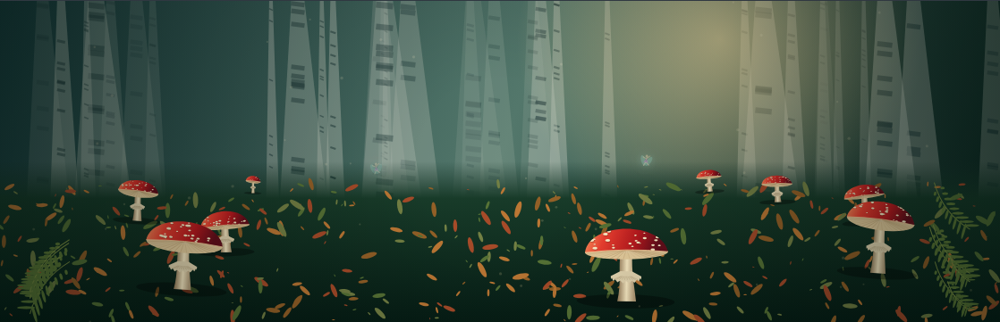

# Seasons: May 2026 – May 2027

**Autumn is in production: creative development underway; not yet released.**

## Collections and player

- Summer: the original 32 visualisations, renamed for their full-on spirit. The Season button identifies this collection as Summer.
- Autumn: another 32 visualisations and their own alchemies, in development.
- One Google Play app and one local player, with the same music library and established playback mechanics.
- Season replaces Shuffle in the existing control slot; it cycles Summer and the Autumn preview. No empty seasons presented as finished.
- Switching seasons must not interrupt the track. Remember each season's last visual and alchemy.
- Background and interface tint reflect the selected season, maintaining control contrast.
- Seasons are selected by the listener, not forced by the calendar.
- Creative scope: visual inspirations from May 2026 to May 2027, changing weathers and lights, outside and inside. This is a creative cycle, not a subscription or availability promise.

## Stable baseline and development

The source snapshot before seasonal changes is commit `33157f6a87a7849cb712c3e5e4ba3bda457077cb`, Android source version 1.0.17 / build 17.

Preserved baseline branch: `baseline/summer-1.0.17-2026-10-16`. Keep this branch at the snapshot; do not develop or merge Autumn into it. This is a branch, not a Git tag. It preserves the current repository state, not a verified match to the live Google Play binary.

Ongoing development, including Autumn, takes place on `master`. Its presence in the repository does not mean the Autumn collection has been released on Google Play.

For a quick fix from the preserved snapshot:

```bash
git fetch origin
git switch -c hotfix/summer-description origin/baseline/summer-1.0.17-2026-10-16
```

Before shipping, confirm the live Play version and matching source commit, then apply the fix to that release base if different. Run the relevant system checks and Android build/release verification, increment the release version, and record the new released commit with its own baseline. Cherry-pick applicable fixes into `master` to avoid losing them.

## Autumn 01 — Ralph's Last Watch

A snowbound hillside. Wolves surround and slaughter the flock. Ralph intercepts attacks and wins individual encounters, but numbers, ferocity, hunger and weather ultimately overcome his defence.

Behaviour: wolves split and flank; sheep cluster and scatter; Ralph responds to the most immediate threat, exposing another flank. Snow impedes movement and visibility. The flock's decline should emerge through the scene rather than happen immediately.

Music supplies movement and atmosphere: bass weights pursuit, percussion accents attacks and turns, higher frequencies stir wind and snow. Quiet passages allow stalking. Use smoothed audio responses so behaviour remains readable. A blizzard eventually conceals the aftermath and introduces a fresh tableau for continuous listening.

Initial alchemies: First Snow; The Hungry Dark; Whiteout; Blood Moon; Red on White. Vary weather, light, palette and behavioural pressures. Proposed treatment: a wide view, strong animal silhouettes and crimson on snow.

Status: first procedural scene draft implemented, with Season switching on desktop and Android assets. Four Autumn scenes are available for evaluation; the remaining slots are yet to be designed. Live Google Play is unchanged.

The full day takes four minutes at 1× visual speed: misty dawn, dark snowy mid-morning, low afternoon glare, a copper-violet sunset, then night. Dawn returns under a snow curtain. GARAGE can hold a particular time of day, adjust pace, snow depth, pack size and slaughter. There is no separate gore ceiling. Autumn Alchemy and the GARAGE Alchemy wheel share seven recipes: First Snow, The Hungry Dark, Whiteout, Blood Moon, Red on White, Woolly Pandemonium and Last Light. Some recipes hold a time of day; choose The whole day in GARAGE to resume the cycle.

The characters and scenery are original procedural drawings with cartoon timing and silhouettes. The slaughter ranges from wool bursts to crimson stains, scattered remains and blood particles; this is a first stylised draft rather than detailed anatomical animation. Pack members choose different targets, retreat from Ralph and exploit limited visibility. Casualties are paced across the day to preserve the narrative. Audio bass changes pursuit energy; treble increases blowing snow. All drawing stays offline.

Season switching leaves audio and library state alone. Per-season visual preferences and alchemical progress survive switches and session restores. Saved shuffle preferences migrate to sequential playback. Summer retains all 32; Autumn exposes its four implemented drafts without placeholders.

## Autumn 02 — Toadstools (A2/32-A)

An original procedural woodland theatre inspired by the fly agaric concept image. Scarlet caps turn and tilt above radial cream gills; stems sway and ruffle their pleated annuli. Smoothed bass drives sway and detected musical transients trigger fresh sprouts among the background mushrooms. Mid frequencies animate the skirts and cap rotation; treble sends travelling light through the gills. Mushrooms release pulses of silver, purple foil, flame and spark spores, with larger showers on intense musical accents and smaller, independently timed waves in the background. Quiet passages keep a gentle breathing motion, without artificial beat triggers. Paused redraws hold the scene still.

GARAGE controls: Woodland light (Golden woodland, Dew at dawn, Moonlit moss, Enchanted gills), Dance, Cap size, Mushrooms and Pixie mischief. Up to three small winged, clothed woodland sprites make intermittent aerial appearances; reducing mischief to zero hides them. The five scene-specific alchemies are Scarlet Matinee, Dew at Dawn, The Skirt Committee, After Hours in the Moss and Spore Score.

The birch woodland, moss, leaves and ferns are cached per canvas size/light treatment. Populations are bounded at 14 mushrooms, three sprites and 240 spores. A clamped delta time and smoothed frequency bands keep motion stable across frame rates and returning tabs. Root and Android offline assets share the same implementation. This is a stylised animated first draft, not an animation of the photographic concept itself; device performance and artistic review remain release checks.

## Autumn 03 — Dawn Cobweb

A procedural web unfolds against the dawn, with two small weavers and dew catching the light. Bass gently stirs the strands and treble strengthens the glints. Five alchemies change the light: First Light, Blue Hour, Rose Morning, Gold Thread and Prismatic Mist. This is an initial artistic draft for desktop comparison; Android device testing is still required.

## Verification

Run `node tools/system-test.js` and `node tools/cobweb-test.js`. Optional integration and native Canvas tests use test-only `jsdom` and `@napi-rs/canvas` dependencies: `NODE_PATH=/path/to/node_modules node tools/season-test.js`. These exercise season switching without transport calls, save/restore, Summer visual retention, scene-specific Autumn Alchemy, the complete day, casualty pacing, repeated musical sprouting, bounded populations, four woodland lighting treatments and matching Android assets.

An Android device build and real-device playback check are required before release. No APK or Play update is produced by this development change.

### Toadstools draft verification

System tests and seasonal integration/Canvas simulation pass. A headless Chromium smoke test played a local WAV with Autumn 02 selected, confirmed active animation with no page errors, rendered landscape and portrait layouts, and restored Autumn 02 after reload. No Android APK was built in this Linux environment; real-device testing remains outstanding.


