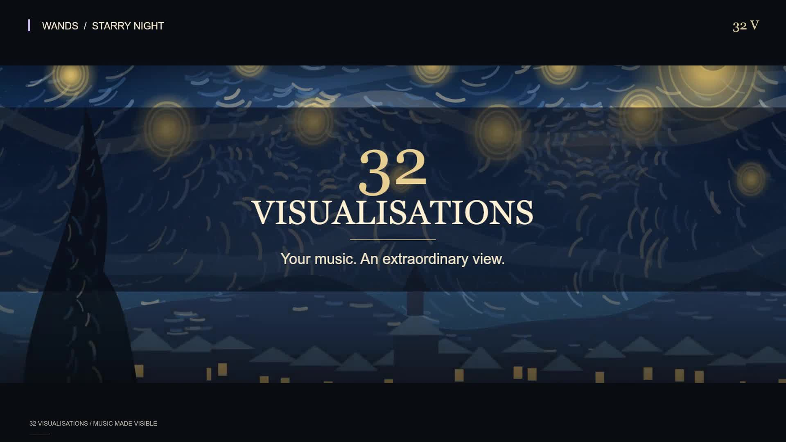

# 32 Visualisations: The Premiere Film

**Your music. An extraordinary view.**

[Watch or download the three-minute GitHub edition](https://github.com/AndyJMyers/32-Visualisations/raw/refs/heads/master/docs/marketing/32v-premiere.mp4). The full-resolution masters and separate portrait/Play edits are retained locally in the folder below.

A three-minute, music-led film across all four Arcana: playful, luminous, intimate, uncanny, industrial and cosmic. Actual player renderers supply the moving art. Champagne-gold editorial titles, quiet credits and six original songs carry the film rather than a voiceover or invented app mock-ups.

## Deliverables

Local folder: `C:\Users\mr__b\Documents\Codex\2026-06-18\hi-we-had-a-reboot-so\outputs\32V-Premiere`

| File | Purpose |
| --- | --- |
| `32V-Premiere-YouTube-Rumble-1080p.mp4` | Three-minute 1920 x 1080 master, 30 fps |
| `32V-Premiere-Instagram-1080x1920.mp4` | Three-minute 1080 x 1920 portrait composition, 30 fps |
| `32V-Premiere-GitHub-540p.mp4` | Smaller, three-minute 960 x 540 review/share copy |
| `32V-Play-Preview-60s.mp4` | Concise landscape preview, established visuals, no price or ranking claims |
| `poster-5-wide.jpg` | Opening title artwork |
| `poster-63-wide.jpg` | Champagne Fountain artwork |
| `poster-5-portrait.jpg` | Portrait title artwork |
| `shot-contact-sheet.jpg` | All 25 shots for review |
| `edit-manifest.json` | Exact sources, shot timings, treatments, titles and credits |
| `soundtrack-edit.wav` | Local, uncompressed soundtrack assembly; not for repository upload |

All videos use H.264 video, AAC stereo audio, square pixels and a fast-start MP4 container. Portrait is recomposed, not a centre-crop of the landscape master. Its music titles and main messages sit above the bottom platform overlays. Widescreen uses a consistent editorial title/footer frame so the scenes' native captions cannot collide with film titles. UI inserts are actual desktop and Android screenshots; the surrounding artwork is moving renderer output.

## Credits

- **Andy J Myers:** creative direction, engineering management, original music and creative production.
- **OpenAI Codex:** engineering and creative collaboration.
- No OpenAI endorsement, sponsorship or independent award is claimed.

## Soundtrack

Six 32-second excerpts, with 2.4-second equal-power crossfades and matched loudness:

| Film Start | Song | Source Start |
| --- | --- | --- |
| 00:00 | Mr Flufferlumps Comes to Tea | 00:12 |
| 00:29.6 | Salt Light Litany | 00:35 |
| 00:59.2 | Goddess of Last Resort | 00:45 |
| 01:28.8 | Canonical Baklava | 00:35 |
| 01:58.4 | Lots Going On Here | 00:35 |
| 02:28 | Paraguay Isn't For Me, Pet | 00:30 |

Bass, midrange and treble are measured from the final soundtrack edit and fed to the same scene modules used by the player. The code pre-rolls each scene to its selected moment, then runs it normally during the shot. Scene transitions are short dissolves; title and credit overlays fade independently.

## Suggested Upload Copy

**Title:** 32 Visualisations | Your Music. An Extraordinary View.

Your music deserves more than a progress bar.

Step into 32 Visualisations: an independent music player where your own files conduct colour, motion and story. Four Arcana bring together dreamscapes, fine-art reveries, machinery, mischief and journeys into the unknown. Alchemy transforms the atmosphere. Dual flywheels and text search keep your collection close.

Local files. Offline listening. No cloud account, advertising or subscription. Pay once. Keep playing.

Creative direction and original music: Andy J Myers.
Engineering and creative collaboration: OpenAI Codex.

This film includes current development work, including Busy as a Bee, Punting with Ladies, Boiling Pot and Kola Superdeep Borehole. The latter two are explicitly labelled development previews; the film does not claim every scene is in the currently published Android build. Music is from Andy's own collection and is not bundled with the app.

- [Android on Google Play](https://play.google.com/store/apps/details?id=com.thirtytwovisualisations.app)
- [Desktop player, project and art gallery](https://github.com/AndyJMyers/32-Visualisations)
- [No Cloud. No Account. No Alibi.](https://andyjmyers.substack.com/p/no-cloud-no-account-no-alibi)

## Platform Notes

- YouTube / Rumble: use the landscape master and title artwork. No upload or publication is performed by the rendering script.
- Instagram: use the portrait composition. Core titles sit away from the extreme top and bottom; inspect the account's posting preview for its UI overlays and profile crop.
- GitHub: use the smaller review copy as an uploaded attachment or release asset, then link/embed the returned asset URL. Keep the full-resolution masters outside Git history.
- Play: use the 60-second preview, uploaded to YouTube as public or unlisted, embeddable, without ads or age restriction, then add that URL in Play Console. It omits Busy as a Bee and the later development shots, showing scenes from the original 64 instead. Check the scenes against the current production build before submission. This file contains neither a comparative "best" claim nor a price/discount callout.

Google's [preview-video guidance](https://support.google.com/googleplay/android-developer/answer/9866151?hl=en-GB) calls for the actual experience early, representative footage, legible text, and a short preview. Availability and account-specific platform upload limits should be checked in the respective upload UI.

## Reproduce

Set `NODE_PATH` to the bundled Canvas dependencies, optionally override `FFMPEG_PATH`, `SHOWCASE_LIBRARY`, `SHOWCASE_BAKLAVA` and `SHOWCASE_OUTPUT`, and run `node tools/capture-32v-premiere.js`, followed by `node tools/finish-32v-premiere.js` and `node tools/create-32v-play-preview.js`. The two UI screenshots must already be in the output folder. `--proof` produces a shot contact sheet and selected layout proofs without encoding the film. `--portrait-only` refines just the portrait master. Finally, run `node tools/check-32v-premiere.js` for duration, dimensions, frame rate and full decode verification.

The soundtrack assembly measures approximately -15.8 LUFS integrated, with -2.2 dBFS true peak before AAC encoding. First-pass master files are retained under `_render-cache` during editorial finishing, not published as additional deliverables.

The three-minute masters deliberately avoid an exact visual count or a currency-specific price, so the campaign will not become stale as the collection grows.
