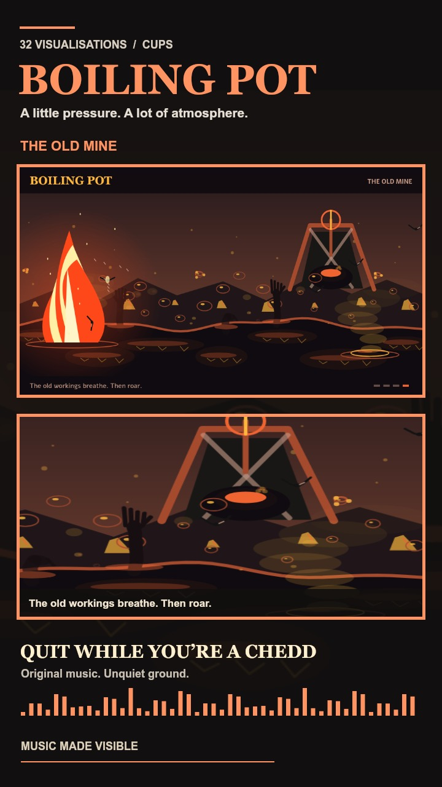

# Boiling Pot

A music-reactive tar-pit world in Cups: rising hands and feet, sulphurous gas, surface ignitions, flame jets, unwary birds, and occasional old-mine explosions.

## One-Minute Teaser

[Watch the portrait promo](boiling-pot-quit-while-youre-a-chedd.mp4)

- Music: Andy's original **Quit While You're a Chedd**, from the local `#1` WAV.
- Duration: 60 seconds, using the track from 00:10 to 01:10.
- Format: 1080 x 1920 portrait, 24 fps, H.264 video and AAC audio, fast-start MP4.
- Alchemies: Tar Black, Sulphur Vein, The Old Mine, then Blue Fire, fifteen seconds each.
- Bass, midrange, and treble energy are measured from the soundtrack to drive the renderer.
- Render source: `tools/capture-boiling-pot-video.js`, using the actual visualisation module.

To reproduce, set `BOILING_MUSIC` to the source WAV and, if needed, `FFMPEG_PATH` and `NODE_PATH`, then run `node tools/capture-boiling-pot-video.js`.
