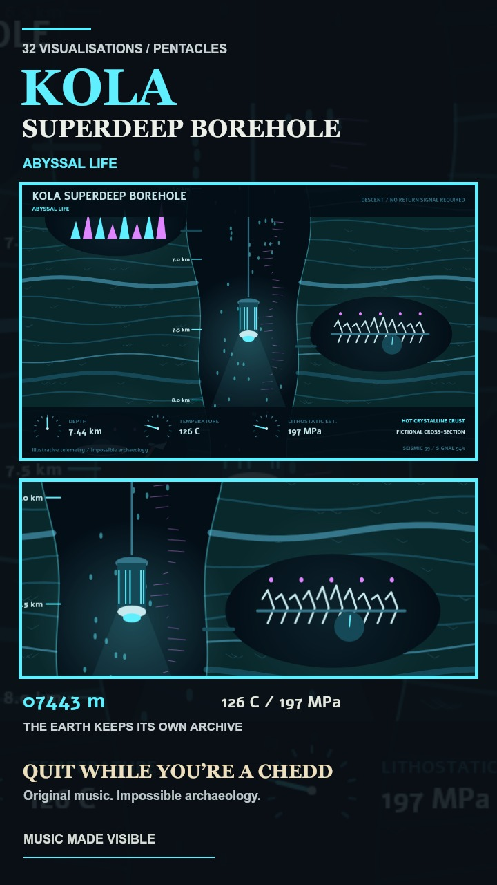

# Kola Superdeep Borehole

A fictional continuous descent in Pentacles: strata scroll upwards past a suspended survey probe, revealing creatures, lost cities, strange fossils and flying saucers beside stone axes. Illustrative depth, temperature and pressure instruments accompany the journey.

## Portrait Teaser

[Watch the 40-second teaser](kola-superdeep-chedd-teaser.mp4)

- 1080 x 1920, 24 fps, H.264 / AAC, fast-start MP4.
- Music: Andy's original **Quit While You're a Chedd**, local `#1` WAV, 00:30-01:10.
- Ten seconds each of Survey Amber, Abyssal Life, The Lost Archive and Thermal Inversion.
- Unbroken descent at 2.5x render speed, driven by measured soundtrack bands.
- The discoveries and telemetry are fictional; the real borehole limit of 12,262 m is marked before the speculative extension.

The depth benchmark is documented in [New geothermal data from the Kola superdeep well SG-3](https://www.sciencedirect.com/science/article/pii/S0040195199000657). The renderer's simplified temperature and lithostatic-pressure estimates are artistic instruments, not a reconstruction of that research.

Reproduce with `KOLA_MUSIC` set to the source WAV, `NODE_PATH` set to the Canvas dependencies and, if required, `FFMPEG_PATH`, then run `node tools/capture-kola-video.js`.
